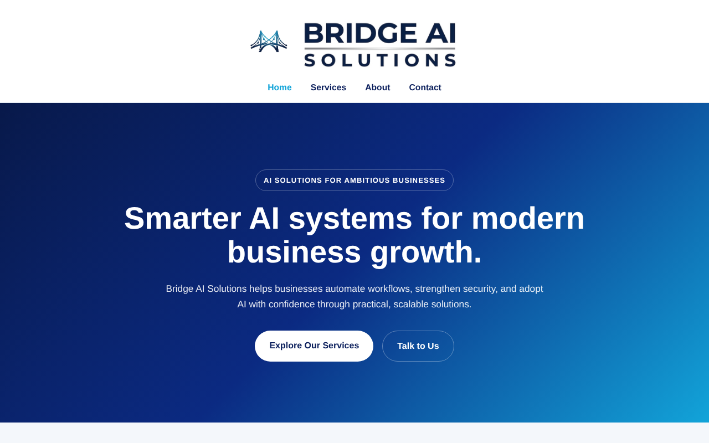

# Bridge AI Solutions Website

A multi-page, responsive business website for a fictional AI services company. Built by a team of four for **COM109 Client-Side Development** at Ulster University (Group 10).

**🔗 Live demo:** https://valevana.github.io/BridgeAISolutions/CW2ClientSide/




## My role: lead developer
- Built the site foundation, including the shared header and footer used on every page
- Built the **Services** page
- Organised the file structure and linking between pages
- Set up and managed this GitHub repository and the GitHub Pages deployment

## Features
- **Responsive layout:** CSS media queries adapt the site for mobile and desktop
- **Interactive Services page:** expandable service cards, hover animations and reveal-on-scroll effects
- **Accessibility:** ARIA attributes, alt text and clear navigation labels
- **Four pages:** Home, Services, About and Contact

## Project structure
```
CW2ClientSide/
├── index.html / index.css / index.js        # Home
├── service.html / services.css / services.js # Services
├── about.html / about.css / about.js         # About
├── contact.html / contact.css / contact.js   # Contact
└── images/                                   # Logos, icons and photos
```

## Run locally
Clone the repo and open `CW2ClientSide/index.html` in a browser. No build step is needed.

```bash
git clone https://github.com/valevana/BridgeAISolutions.git
```

---
*Created for educational purposes as part of a university assignment. Bridge AI Solutions is a fictional company.*
